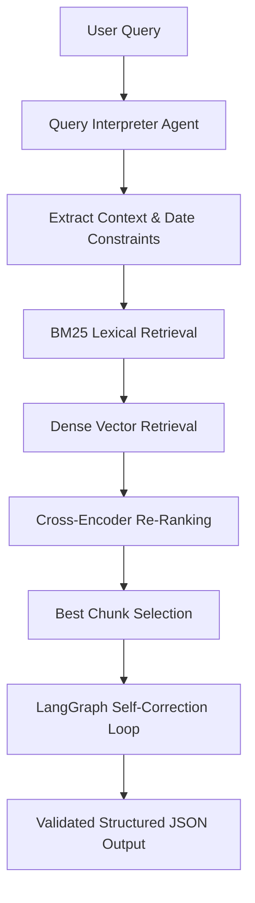
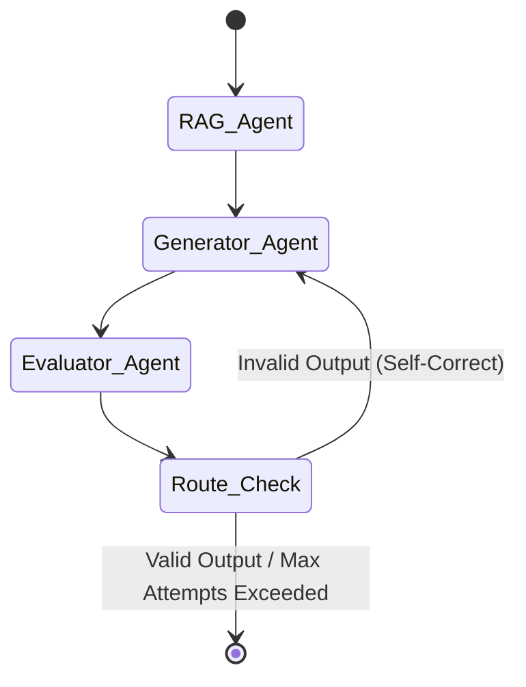

# Hybrid Agentic RAG System for Academic Paper Intelligence

This repository implements a **query-aware, agent-driven Hybrid Retrieval-Augmented Generation (RAG) system** for academic research papers.

Unlike naive RAG systems that directly embed the raw user query, this system first **interprets the query using an agent**, extracting **intent, keywords, and temporal constraints**. These signals are then used to drive a **BM25-first lexical search**, followed by **dense semantic retrieval**, **cross-encoder re-ranking**, and a **LangGraph-based agentic self-correction workflow** to guarantee schema-safe structured outputs.

---

## Core Design Principles

- **Query Interpretation:** Decouple raw queries from vector search by extracting structured filters and intents first.
- **Hybrid Search:** Combine BM25 lexical search (critical for keyword and date-based constraints) with dense semantic search (for conceptual recall).
- **Reranking:** Leverage cross-encoders to evaluate absolute relevance of candidates.
- **Agentic Validation:** Keep LLMs in a self-correcting validation loop until Pydantic schema validation succeeds.
- **Deterministic Execution:** Maintain controlled state transitions using LangGraph.

---

## Project Structure

```
├── scraper/
│   └── scraper.py              # Academic paper scraping & normalization
│
├── data/
│   └── cscl_dataset.json       # Structured raw dataset of papers
│
├── data_ingestion/
│   └── ingestion.py            # Text chunking, embedding generation & storage
│
├── chroma_store/               # Persistent on-disk vector database (ignored in git)
│
├── langgraph_agents/           # LangGraph-based workflow
│   ├── __init__.py
│   ├── agents.py               # RAG, Generator, and Evaluator agents/nodes
│   ├── graph.py                # Graph building and routing configuration
│   ├── graphstate.py           # State definition passed across nodes
│   ├── prompts.py              # Centralized system and correction prompts
│   └── schema.py               # Pydantic structured output models
│
├── agents/                     # Traditional pipeline components
│   ├── controller.py           # Plain loops-based orchestrator
│   ├── json_creator.py         # JSON creation LLM interface
│   ├── validator.py            # Output validator helper
│   └── schema.py               # Pydantic schema definition
│
├── langgraph_run.py            # Entry point for LangGraph pipeline
├── run.py                      # Entry point for traditional pipeline
├── requirements.txt            # Python dependencies
└── utils.py                    # Utility functions and shared helpers
```

---

## High-Level System Flow



---

## System Components

### 1. Data Scraping
**Location:** [scraper/scraper.py](file:///Users/amogharora/agentic_rag_system/agentic_rag_system/scraper/scraper.py)

- Scrapes **50 academic research papers** in the domain.
- Extracts key metadata and raw content.
- Normalizes output into a structured dataset: `data/cscl_dataset.json`.

**Paper schema:**
- `paper_id`
- `title`
- `abstract`
- `authors`
- `submission_date`
- `content`
- `references`

**Run Command:**
```bash
python scraper/scraper.py
```

---

### 2. Data Ingestion & Vectorization
**Location:** [data_ingestion/ingestion.py](file:///Users/amogharora/agentic_rag_system/agentic_rag_system/data_ingestion/ingestion.py)

- Loads the scraped dataset.
- Splits long papers into overlapping chunks to preserve contextual boundaries.
- Generates dense semantic embeddings using Sentence-Transformers (`all-MiniLM-L6-v2`).
- Indexes chunks in `ChromaDB` alongside rich metadata (such as dates, title, and authors).

**Run Command:**
```bash
python data_ingestion/ingestion.py
```

---

### 3. Query Interpretation Layer
Before searching the vector database, the raw user query is processed by a **Query Interpreter Agent** to identify:
- Real core intent & target keywords.
- Temporal bounds (e.g., "published after 2021", "recent advancements").
- Structured filters for the retrieval stage.

---

### 4. Hybrid Retrieval Pipeline
1. **BM25 Lexical Retrieval (Primary Filter):** Focuses on strict keyword matching and date filters. Ensures constraints are respected.
2. **Dense Vector Retrieval (Bi-Encoder):** Searches ChromaDB using cosine similarity to guarantee high semantic recall.
3. **Cross-Encoder Re-Ranking:** Re-ranks the top 20 retrieved candidates using `cross-encoder/ms-marco-MiniLM-L-6-v2` to select the single highest-scoring chunk.

---

### 5. LangGraph Agentic Workflow
Once the best context is retrieved, the system uses a LangGraph control loop to guarantee structured, valid schema outputs.



#### Shared Graph State (`graphstate.py`)
- `query`: User search topic
- `date`: Extracted temporal constraints
- `rag_results`: List of retrieved documents
- `rag_context`: Best combined text content
- `generated_json`: Candidate output dict
- `evaluation_errors`: List of validation errors, if any
- `attempts`: Counter tracking retries (Max = 3)

#### Execution Nodes (`agents.py`)
- **RAG Agent:** Performs hybrid query execution.
- **Generator Agent:** Leverages LLM to create schema-conforming response.
- **Evaluator Agent:** Validates output structures against the Pydantic schema.

---

### 6. Structured Output Schema
Outputs strictly adhere to the following structure:
```json
{
  "title": "string",
  "summary": "string",
  "complexity_score": 1-10,
  "future_work": "string"
}
```

> [!IMPORTANT]
> The generator output must be pure JSON with no markdown wrapping, trailing strings, or conversational preambles.

---

## Getting Started

1. **Install Dependencies:**
   ```bash
   pip install -r requirements.txt
   ```
2. **Configure Environment:**
   Create a `.env` file and define your API keys:
   ```env
   GEMINI_API_KEY=your_gemini_api_key_here
   ```
3. **Execution Options:**
   - Run the traditional controller-based workflow:
     ```bash
     python run.py
     ```
   - Run the LangGraph-based workflow:
     ```bash
     python langgraph_run.py
     ```

---

## Future Enhancements
- [ ] Implement adaptive weight calibration between BM25 and Dense search models.
- [ ] Add support for multi-document synthesis and cross-paper referencing.
- [ ] Set up automated retrieval metrics tracking (Recall@K, MRR).
- [ ] Integrate streaming and async execution for faster processing times.
- [ ] Containerize application via Docker and expose REST APIs.