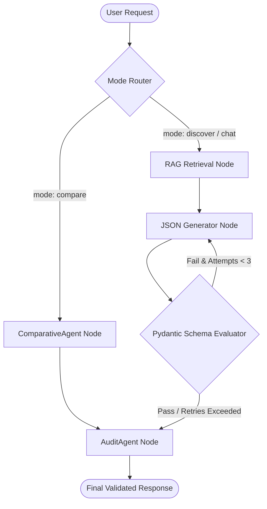

# Research Explorer (Hybrid Multi-Agent RAG System)

This repository implements a **query-aware, agent-driven Hybrid Retrieval-Augmented Generation (RAG) system** for academic research papers, complete with a React frontend and a FastAPI backend.

Unlike naive RAG systems that directly embed the raw user query, this system first **interprets the query using an agent**, extracting intent, keywords, and temporal constraints. These signals are then used to drive a **BM25-first lexical search**, followed by **dense semantic retrieval**, **cross-encoder re-ranking**, and a **LangGraph-based multi-agent workflow** to guarantee schema-safe structured outputs and provide deep literature reviews.

---

## 🌟 Core Design Principles & RAG Architecture

### 1. Query Interpretation
Before searching the vector database, the raw user query is processed by a **Dynamic Date Extraction Agent** to identify:
- Real core intent & target keywords.
- Temporal bounds (e.g., "papers published after 2025", "recent advancements").
- Structured filters for the retrieval stage.

### 2. Hybrid Retrieval Pipeline
1. **BM25 Lexical Retrieval (Primary Filter):** Focuses on strict keyword matching and date string prefix filtering. Ensures temporal constraints are respected.
2. **Dense Vector Retrieval (Bi-Encoder):** Searches ChromaDB using cosine similarity to guarantee high semantic recall.
3. **Cross-Encoder Re-Ranking:** Re-ranks the top retrieved candidates using `cross-encoder/ms-marco-MiniLM-L-6-v2` to evaluate absolute relevance, selecting the most contextually relevant chunks.

### 3. LangGraph Multi-Agent Workflows
Once the best context is retrieved, the system uses a LangGraph control loop to guarantee structured, valid schema outputs, driven by specialized agents:
- **Summarization & Validation Agent:** Generates strict Pydantic JSON summaries and automatically self-corrects if the output schema is invalid (Max attempts = 3).
- **ComparativeAgent (Literature Review):** When discovering multiple relevant candidate papers, this agent synthesizes a side-by-side matrix comparing methodologies, strengths, limitations, and compute overheads.
- **AuditAgent (Fact-Checker):** Every generated summary and comparative review is passed through a factual grounding auditor that computes a **Hallucination Score (0-100%)** by cross-referencing generated claims against the raw retrieved ChromaDB chunks.

---

## 🔌 FastAPI Backend Endpoints

The backend is built using **FastAPI** (`server.py`), exposing a series of REST endpoints that interface directly with the LangGraph state graph and ChromaDB:

*   **`GET /api/papers`**: Fetches all available research papers currently indexed in the local store.
*   **`POST /api/search`**: Takes a natural language query and optional date, parses them via the intent extraction agent, and executes the hybrid search pipeline.
*   **`POST /api/summarize`**: Invokes the LangGraph state machine in `"discover"` mode to produce a schema-safe JSON summary with self-correction and validation.
*   **`POST /api/compare`**: Invokes LangGraph in `"compare"` mode to synthesize literature reviews across multiple paper IDs.
*   **`POST /api/chat`**: Performs grounded conversational Q&A against the retrieved text of a selected paper.
*   **`POST /api/upload_pdf`**: Accepts custom PDF uploads, parses content using `pdfplumber`, splits it into chunks, embeds them, and persists them into the ChromaDB vector database.

---

## 🎨 React Frontend Architecture

The user interface is built on **React (Vite)** with standard styling and modular components designed for research exploration:

*   **`Sidebar.jsx`**: Houses the search filter, paper count, list of available papers, and the "Upload PDF" action trigger.
*   **`SummaryCard.jsx`**: Displays key findings, complexity score, and future work. Offers a toggle button to view raw JSON outputs.
*   **`ComparativeMatrix.jsx`**: Dynamically generates a side-by-side matrix table showing methodology, strengths, limitations, and compute overhead for compared papers. It displays a live **Audit Factual Grounding Badge** calculated by the fact-checking agent.
*   **`ChatWindow.jsx`**: Grounded chat terminal interface that enables users to ask specific questions about the chosen paper in real-time.
*   **`PdfUploadModal.jsx`**: Modal dialog for handling paper uploads, title, author, and date metadata entries.

---

## 🏗️ Project Structure

```
├── frontend/                   # React (Vite) Web Application
│   ├── src/components/         # UI Components (ComparativeMatrix, SummaryCard, etc.)
│   └── src/App.jsx             # Main Application Logic
│
├── langgraph_agents/           # Multi-Agent State Machine Workflow
│   ├── agents.py               # RAG, Generator, Comparative, and Audit Agents
│   ├── graph.py                # LangGraph routing and compilation
│   ├── graphstate.py           # State typing passed across nodes
│   ├── prompts.py              # Centralized system prompts
│   └── schema.py               # Pydantic structured output models
│
├── data_ingestion/             # Text chunking, embedding & ChromaDB storage
├── rag/                        # Hybrid search logic (BM25 + Dense + Reranker)
├── scraper/                    # Academic paper scraping & normalization
│
├── server.py                   # FastAPI Backend Server
├── langgraph_run.py            # CLI entry point for testing the LangGraph pipeline
└── requirements.txt            # Python dependencies
```

---

## 🧠 LangGraph State Machine Flow



---

## 🚀 Getting Started

### 1. Prerequisites & Environment
Ensure you have Python 3.11+ and Node.js installed. Create a `.env` file in the root directory with your Google Gemini API key:
```env
GEMINI_API_KEY=your_gemini_api_key_here
```
*(The system is currently configured to use **Gemini 3.1 Flash Lite** and **Gemini 3 Pro Preview** via Google's `genai` SDK and LangChain).*

### 2. Backend Setup
Install Python dependencies, perform initial ingestion, and start the FastAPI server:
```bash
python -m venv .venv
source .venv/bin/activate
pip install -r requirements.txt

# (Optional) Run initial data scraping and ingestion
python scraper/scraper.py
python data_ingestion/ingestion.py

# Run the FastAPI server (runs on port 8000)
python server.py
```

### 3. Frontend Setup
In a new terminal window, install npm packages and start the Vite dev server:
```bash
cd frontend
npm install
npm run dev
```
Navigate to **http://localhost:5173** to use the Web UI.

---

## 🛠️ Execution & Testing (CLI)

If you prefer to run evaluations or tests from the command line without the UI, you can use the interactive LangGraph runner:

```bash
python langgraph_run.py
```
This CLI tool allows you to:
1. Search and discover papers using the hybrid retriever.
2. Select a paper to trigger the Agentic Validation Loop.
3. Enter a multi-turn chat environment grounded in the selected paper.

---

## 🛡️ Model Robustness
The system implements a resilient `call_llm_with_fallback` function inside `agents.py` to handle API `429 Resource Exhausted` rate-limits. If the primary model exceeds quota, the system automatically triggers an exponential backoff sleep before retrying.

---

## 🔮 Future Work
- Implement automated retrieval metrics tracking (Recall@K, MRR) for the hybrid pipeline.
- Add support for multi-document synthesis and cross-paper referencing inside the chat window.
- Migrate from local ChromaDB to a cloud-hosted Vector DB for multi-tenant scaling.
- Dockerize both the FastAPI backend and React frontend into a unified `docker-compose.yml`.